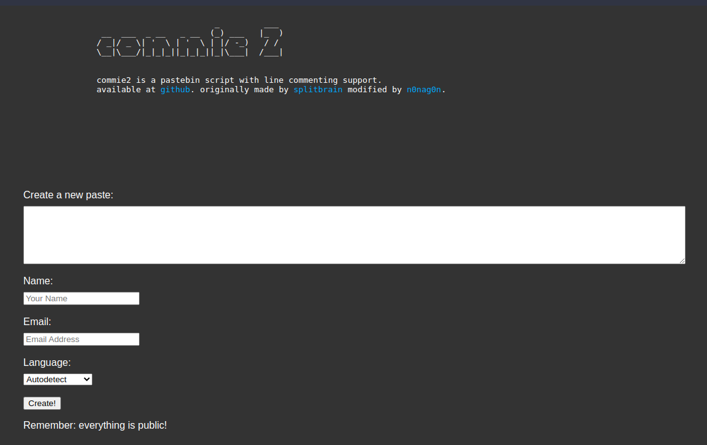
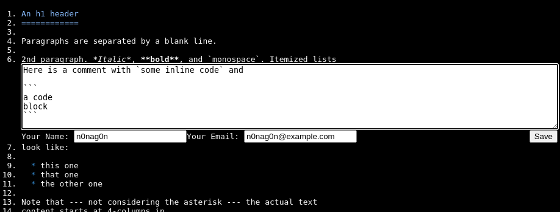
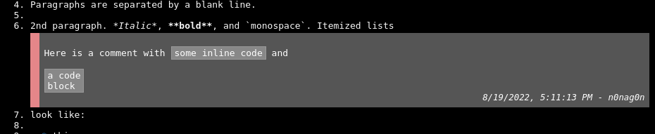
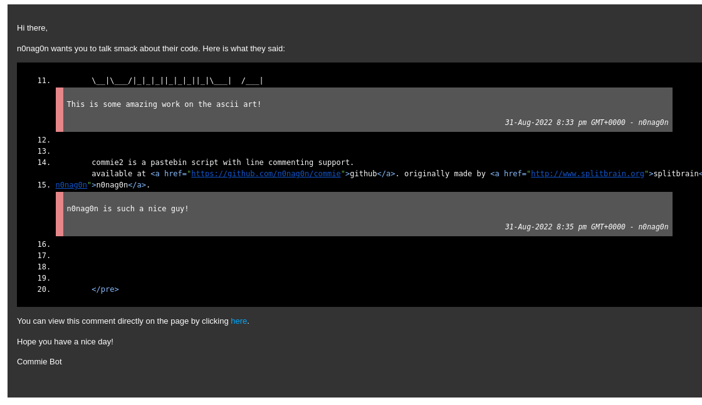
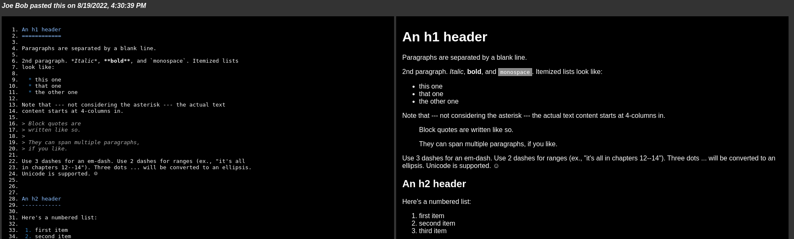

# commie2

commie 2.0 is a pastebin script with line commenting support. This was originally forked from [splitbrain/commie](https://github.com/splitbrain/commie) and further improved and expanded upon.

To view a demo of commie2, [click here](https://commie2.sky-9.com/). Emailing has been disabled for potential abuse cases.

## Features
- Pastes are stored as files on the filesystem, encrypted at rest. (no need to configure a database, or plugins, etc.)
- Every line is commentable with the ability for multiple comments from multiple users.
- Comments support Github Markdown!
- Names and emails are cookied for better UX, but easily changeable.
- When you make a comment, the user that made the paste can (optionally) receive an email, with syntax highlighted context of the comment and any other contextual comments. (see screenshots)
- If the paste is markdown, it will auto generate a preview in html (see screenshots)
- Way simple interface and codebase. When I forked it, it took maybe 5 minutes to figure out what was going on.
- Upgraded to modern architecture to keep only public things in the public directory.
- Compatible with PHP >=7.4 (PHP 8.x recommended for new deployments)
- Built with:
   - [htmx](https://htmx.org/) for simple SPA functionality. 
   - [hyperscript](https://hyperscript.org) - adds simple javascript functionality that is very easy to read.
   - [latte](https://latte.nette.org) - for templating engine that honestly is really nice. Better than Twig IMO.
   - [scrivo/highlight.php](https://github.com/scrivo/highlight.php) - port of [highlight.js](https://github.com/highlightjs/highlight.js/) with support for many languages.
   - [flight framework](https://docs.flightphp.com) - lightweight framework that is very easy to use and understand. 

## Install
1. Clone this repo
2. Run `composer install`
3. Copy `app/config/.config_sample.php` to `app/config/.config.php` and configure it (see Configuration below)
4. Ensure the `data/` directory exists and is writable by your webserver user
5. Point your webserver document root to the `public/` directory

If you use Apache, a `.htaccess` file is already configured in `public/`. For nginx and other servers, see the [Flight install docs](https://docs.flightphp.com/install).

## Configuration
Copy [`app/config/.config_sample.php`](app/config/.config_sample.php) to `app/config/.config.php`.

**Required before first use:**
- `encryption_key` — generate with `vendor/bin/generate-defuse-key` and paste the value into your config. Pastes cannot be stored or read without this.
- `app_base_url` — your public site URL with a trailing slash (used in notification emails)

**Optional:**
- `api_key` — only needed if you use the HTTP API (`vendor/bin/generate-defuse-key` can generate one)
- `enable_smtp` and `smtp` settings — for comment notification emails

## API
The API is simple to use and make new pastes to. You authenticate by sending an `Authorization: Bearer apikey` header in the request. If you need another header, you can also use the `X-Authorization: Bearer apikey` header.
### New Paste
```
POST /api/paste/create

Request Parameters (all required)
---------
content=yourpaste
name=Your+name
email=your@email.com
language=php (optional, the autodetect is pretty good)

Response
-----------
{"uid":"youruid"}
```

### New Comment
```
POST /api/paste/@paste_uid/comment/@line_number/create

Parameters (all required)
---------
comment=yourcomment
name=Your+name
email=your@email.com

Response
-----------
{
	"uid":"youruid",
	"line":5,
	"comment":"yourcomment",
	"name":"Your name",
	"email":"your@email.com",
	"time":1661023034, // from php time() command
	"color":"abc123" // color based on name of user
}
```

## Testing
Run the test suite with:

```
composer test
```

Or directly:

```
vendor/bin/phpunit
```

## Screenshots
#### Home Page


#### Making a comment


#### Viewing comment


#### Comment via Email


#### Markdown Paste Example


## Contributing
Throw in an issue and if necessary make a pull request. It's a pretty simple codebase!

### Security
If you find a security issue, please open a GitHub issue or pull request.

**Deployment recommendations:**
- Serve over HTTPS in production
- Keep dependencies updated (`composer update` and `composer audit`)
- Set a strong `encryption_key` and `api_key` (API only)
- Consider HTTP Basic Auth or network restrictions for private instances, especially if SMTP is enabled
- Be aware that comment timezone detection sends visitor IPs to a third-party geo-IP service

## Tips
- If you are going to enable email, it would probably be best to put some controls in place to the paste board (such as only certain users can access the URL, HTTP Basic Auth, etc)

## Troubleshooting
Got questions? Here's some common ones...

#### My pastes won't save!
Make sure that your `data/` directory is writable by the webserver user (www-user, apache, nobody, nginx, etc). Something like `chmod g+w data/` should do the trick. If it you need to also change the owner, do so with `chown apache:apache data/` or whatever user you need.

#### Ok I did that, but they still won't save!
Do you have SELinux enabled? You can check with `sestatus` as root and see. If you do have it enabled, you need to make sure that the `data/` dir has the correct context permissions which would likely be something like `semanage fcontext -a -t httpd_sys_rw_content_t "/path/to/commie2/data(/.*)?"` and then run `restorecon -Rv /path/to/commie2/`

## License
[MIT License](LICENSE.md)